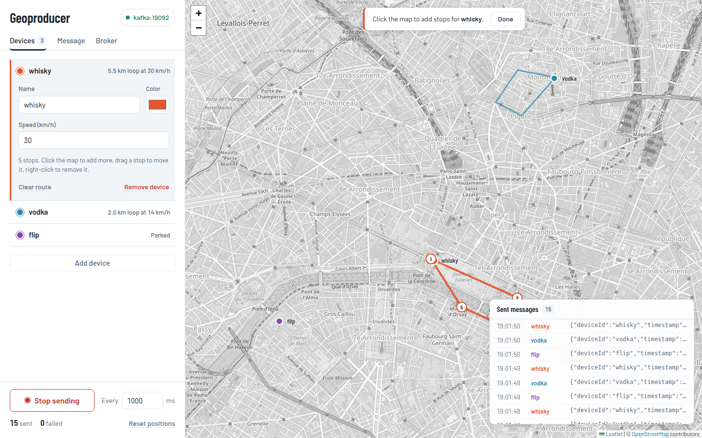

# kafka-geoproducer-ui

Simulate a fleet of GPS devices and stream their positions to a Kafka topic as JSON.



- Place devices on a map and draw routes. Each device loops around its stops at its own speed.
- Shape the message: rename or drop the built-in fields (device name, timestamp, latitude, longitude, speed, heading) and add fixed values, random numbers or random choices.
- Every tick, each placed device sends one message, keyed by its name, so a device's messages stay in one partition.
- Watch messages go out in the live log. The brokers, topic, fields and devices are saved in the browser.

## Run it with Docker

```bash
docker compose up --build
```

This starts a single-node Kafka and the app on <http://localhost:4000>, already pointed at that Kafka. To watch the messages arrive:

```bash
docker compose exec kafka /opt/kafka/bin/kafka-console-consumer.sh \
  --bootstrap-server localhost:9092 --topic device-locations --property print.key=true
```

## Develop

Requires Node 22.18+ and pnpm.

```bash
pnpm install
docker compose up -d kafka   # or bring your own broker on localhost:9092
pnpm dev                     # UI on http://localhost:5173, API on :4000
pnpm test
```

The server reads `KAFKA_BROKERS` (default `localhost:9092`) and `PORT` (default `4000`). Brokers typed into the UI take precedence.

Only plaintext brokers are supported for now. SASL and TLS aren't wired up. The server connects to whatever brokers the UI asks for, so don't expose it publicly.
